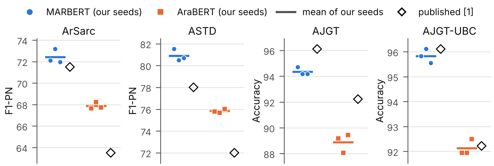
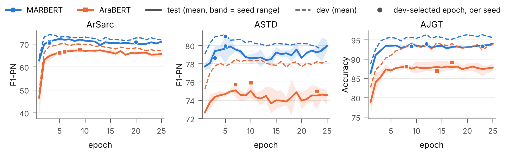
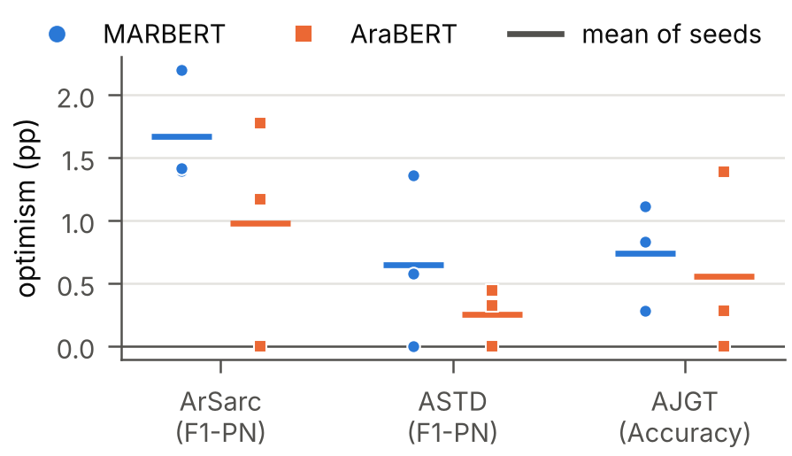
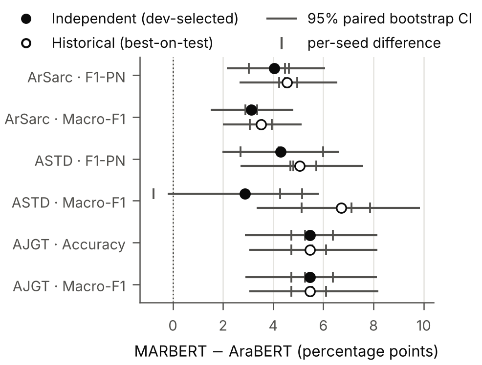
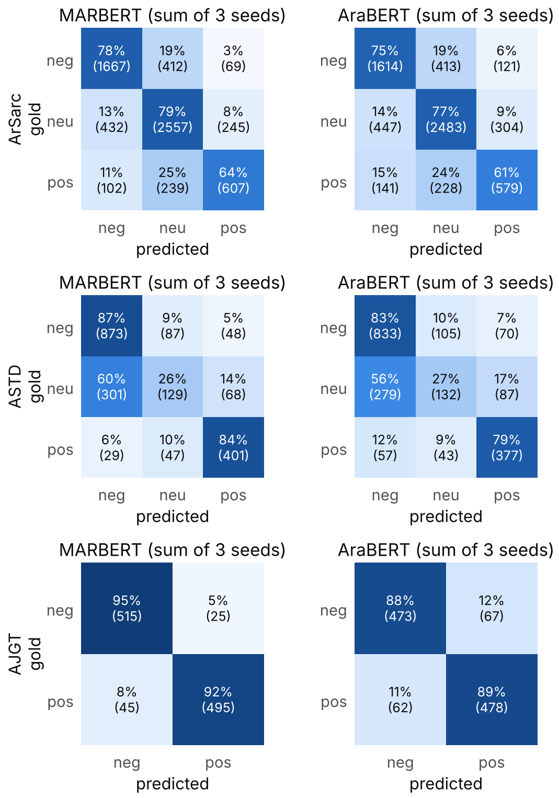

# Results summary

Completed runs: **36 / 36** (plus 6 AJGT check runs on the authors' split and 6 single-seed follow-up runs). All numbers are regenerated from the saved predictions by `scripts/make_report_assets.py`; scores are on a 0-100 scale, mean ± SD over seeds 42-44.

## RQ1 - Reproduction (historical protocol: best epoch on test, as in [1])

| Dataset | Metric | Model | [1] | Ours | SD | Min | Max | Gap (pp) | Verdict |
|---|---|---|---|---|---|---|---|---|---|
| ArSarcasm-Sent | f1_pn | MARBERT | 71.50 | 72.42 | 0.66 | 71.97 | 73.18 | 0.92 | reproduced |
| ArSarcasm-Sent | f1_pn | AraBERT | 63.50 | 67.86 | 0.31 | 67.63 | 68.22 | 4.36 | not reproduced |
| ASTD | f1_pn | MARBERT | 78.00 | 80.90 | 0.55 | 80.48 | 81.52 | 2.90 | not reproduced |
| ASTD | f1_pn | AraBERT | 72.00 | 75.83 | 0.17 | 75.68 | 76.01 | 3.83 | not reproduced |
| AJGT | accuracy | MARBERT | 96.11 | 94.35 | 0.32 | 94.17 | 94.72 | -1.76 | reproduced |
| AJGT | accuracy | AraBERT | 92.22 | 88.89 | 0.73 | 88.06 | 89.44 | -3.33 | not reproduced |
| AJGT (authors' split) | accuracy | MARBERT | 96.11 | 95.83 | 0.28 | 95.56 | 96.11 | -0.28 | reproduced |
| AJGT (authors' split) | accuracy | AraBERT | 92.22 | 92.13 | 0.32 | 91.94 | 92.50 | -0.09 | reproduced |

## Main result (independent protocol: epoch chosen on dev with the published metric)

| Dataset | Model | Metric | Mean | SD | Macro-F1 | SD | Dev-selected epochs |
|---|---|---|---|---|---|---|---|
| ArSarcasm-Sent | MARBERT | f1_pn | 70.80 | 0.28 | 73.66 | 0.38 | 20, 3, 3 |
| ArSarcasm-Sent | AraBERT | f1_pn | 66.75 | 0.68 | 70.54 | 0.37 | 5, 6, 9 |
| ASTD | MARBERT | f1_pn | 79.85 | 1.19 | 64.49 | 2.11 | 5, 5, 3 |
| ASTD | AraBERT | f1_pn | 75.55 | 0.49 | 61.61 | 1.60 | 7, 23, 10 |
| AJGT | MARBERT | accuracy | 93.52 | 0.32 | 93.52 | 0.32 | 9, 23, 12 |
| AJGT | AraBERT | accuracy | 88.06 | 1.11 | 88.06 | 1.11 | 14, 8, 17 |

## RQ2 - Checkpoint selection (independent runs)

| Dataset | Model | Metric | Dev-selected | Best on test | Optimism | Max optimism | Dev epochs | Best test epochs |
|---|---|---|---|---|---|---|---|---|
| ArSarcasm-Sent | MARBERT | f1_pn | 70.80 | 72.47 | 1.67 | 2.20 | 20, 3, 3 | 9, 5, 5 |
| ArSarcasm-Sent | AraBERT | f1_pn | 66.75 | 67.74 | 0.98 | 1.78 | 5, 6, 9 | 8, 12, 9 |
| ASTD | MARBERT | f1_pn | 79.85 | 80.50 | 0.65 | 1.36 | 5, 5, 3 | 19, 5, 6 |
| ASTD | AraBERT | f1_pn | 75.55 | 75.80 | 0.25 | 0.44 | 7, 23, 10 | 7, 14, 18 |
| AJGT | MARBERT | accuracy | 93.52 | 94.26 | 0.74 | 1.11 | 9, 23, 12 | 12, 9, 25 |
| AJGT | AraBERT | accuracy | 88.06 | 88.61 | 0.56 | 1.39 | 14, 8, 17 | 21, 8, 10 |

| Dataset | Model | Dev published metric (as run) | Dev macro-F1 (proposal) | Max change in one run |
|---|---|---|---|---|
| ArSarcasm-Sent | MARBERT | 70.80 | 70.96 | 0.49 |
| ArSarcasm-Sent | AraBERT | 66.75 | 66.90 | 0.43 |
| ASTD | MARBERT | 79.85 | 80.22 | 1.10 |
| ASTD | AraBERT | 75.55 | 75.48 | 0.19 |
| AJGT | MARBERT | 93.52 | 93.52 | 0.00 |
| AJGT | AraBERT | 88.06 | 88.06 | 0.00 |

| Dataset | Lead, dev-selected | Lead, best-on-test | Gained by test selection |
|---|---|---|---|
| ArSarcasm-Sent | 4.04 | 4.73 | 0.69 |
| ASTD | 4.30 | 4.70 | 0.39 |
| AJGT | 5.46 | 5.65 | 0.19 |

## RQ3/RQ4 - MARBERT minus AraBERT (95% paired bootstrap, B = 1,000)

| Protocol | Dataset | Metric | Δ mean | Δ SD (seeds) | CI low | CI high | MARBERT wins | Ranking changes with metric |
|---|---|---|---|---|---|---|---|---|
| historical | ArSarcasm-Sent | f1_pn | 4.56 | 0.37 | 2.66 | 6.55 | 3 | False |
| historical | ArSarcasm-Sent | macro_f1 | 3.52 | 0.45 | 2.00 | 5.13 | 3 | False |
| historical | ASTD | f1_pn | 5.06 | 0.57 | 2.69 | 7.58 | 3 | False |
| historical | ASTD | macro_f1 | 6.71 | 1.40 | 3.34 | 9.86 | 3 | False |
| historical | AJGT | accuracy | 5.46 | 0.70 | 3.06 | 8.15 | 3 | False |
| historical | AJGT | macro_f1 | 5.47 | 0.70 | 3.05 | 8.19 | 3 | False |
| independent | ArSarcasm-Sent | f1_pn | 4.04 | 0.89 | 2.14 | 6.07 | 3 | False |
| independent | ArSarcasm-Sent | macro_f1 | 3.12 | 0.23 | 1.52 | 4.80 | 3 | False |
| independent | ASTD | f1_pn | 4.30 | 1.65 | 1.98 | 6.63 | 3 | False |
| independent | ASTD | macro_f1 | 2.88 | 3.20 | -0.21 | 5.82 | 2 | False |
| independent | AJGT | accuracy | 5.46 | 0.85 | 2.87 | 8.15 | 3 | False |
| independent | AJGT | macro_f1 | 5.46 | 0.85 | 2.90 | 8.14 | 3 | False |

## ArSarcasm subgroups (MARBERT minus AraBERT, 95% paired bootstrap, B = 2,000)

| Protocol | Group | n | Metric | Δ mean | CI low | CI high |
|---|---|---|---|---|---|---|
| historical | sarcastic | 345 | macro_f1 | -0.97 | -4.44 | 2.11 |
| historical | sarcastic | 345 | f1_pn | 1.29 | -1.78 | 4.71 |
| historical | non-sarcastic | 1765 | macro_f1 | 4.01 | 2.23 | 5.93 |
| historical | non-sarcastic | 1765 | f1_pn | 5.22 | 2.97 | 7.60 |
| independent | sarcastic | 345 | macro_f1 | -2.59 | -7.15 | 1.95 |
| independent | sarcastic | 345 | f1_pn | -0.47 | -4.79 | 3.99 |
| independent | non-sarcastic | 1765 | macro_f1 | 3.43 | 1.64 | 5.26 |
| independent | non-sarcastic | 1765 | f1_pn | 4.40 | 2.11 | 6.76 |
| historical | msa | 1410 | macro_f1 | 2.95 | 1.11 | 4.87 |
| historical | msa | 1410 | f1_pn | 3.83 | 1.48 | 6.33 |
| historical | egypt | 479 | macro_f1 | 4.02 | 0.68 | 7.75 |
| historical | egypt | 479 | f1_pn | 4.66 | 1.27 | 8.47 |
| historical | gulf | 105 | macro_f1 | 10.35 | 3.36 | 17.83 |
| historical | gulf | 105 | f1_pn | 12.39 | 5.04 | 21.06 |
| historical | levant | 112 | macro_f1 | 2.84 | -5.37 | 10.75 |
| historical | levant | 112 | f1_pn | 4.85 | -4.83 | 14.81 |
| independent | msa | 1410 | macro_f1 | 1.91 | -0.17 | 3.88 |
| independent | msa | 1410 | f1_pn | 2.36 | -0.23 | 4.89 |
| independent | egypt | 479 | macro_f1 | 4.48 | 1.01 | 7.87 |
| independent | egypt | 479 | f1_pn | 5.66 | 2.03 | 9.07 |
| independent | gulf | 105 | macro_f1 | 7.61 | 0.35 | 15.58 |
| independent | gulf | 105 | f1_pn | 9.85 | 2.27 | 18.59 |
| independent | levant | 112 | macro_f1 | 5.59 | -3.11 | 14.30 |
| independent | levant | 112 | f1_pn | 6.33 | -4.01 | 16.64 |

## Follow-up runs (seed 42, ArSarcasm-Sent, historical protocol)

| Variant | Model | F1-PN | vs main run | vs [1] |
|---|---|---|---|---|
| AraBERT v0.1, AraBERT's official preprocessing | arabert | 68.75 | 1.12 | 5.25 |
| AraBERT v1 with Farasa segmentation | arabert | 67.90 | 0.27 | 4.40 |
| Constant LR 2e-5 (10x) | arabert | 67.60 | -0.03 | 4.10 |
| Constant LR 2e-5 (10x) | marbert | 71.67 | -0.45 | 0.17 |
| Linear decay + 10% warm-up, LR 2e-6 | arabert | 68.06 | 0.43 | 4.56 |
| Linear decay + 10% warm-up, LR 2e-6 | marbert | 72.17 | 0.05 | 0.67 |

## Compute

| Protocol | Dataset | GPU-hours |
|---|---|---|
| historical | arsarcasm | 1.17 |
| historical | astd | 3.86 |
| historical | ajgt | 0.21 |
| independent | arsarcasm | 1.06 |
| independent | astd | 3.53 |
| independent | ajgt | 0.20 |
| both | arsarcasm | 2.23 |
| both | astd | 7.39 |
| both | ajgt | 0.41 |
| all | all | 10.03 |

## Cross-check against the team's own result files

| Check | Values | Max |difference| | Match |
|---|---|---|---|
| reproduction: mean over seeds | 6 | 0.00 | True |
| reproduction: SD over seeds | 6 | 0.00 | True |
| independent: dev-selected mean | 6 | 0.00 | True |
| independent: best-on-test mean (same runs) | 6 | 0.00 | True |
| checkpoint: dev-selected epoch | 18 | 0.00 | True |
| checkpoint: selection optimism per run | 18 | 0.00 | True |
| paired bootstrap: observed_diff (per seed and mean) | 48 | 0.00 | True |
| paired bootstrap: ci_low (per seed and mean) | 48 | 0.00 | True |
| paired bootstrap: ci_high (per seed and mean) | 48 | 0.00 | True |
| subgroup bootstrap: mean_diff | 24 | 0.00 | True |
| subgroup bootstrap: ci_low | 24 | 0.00 | True |
| subgroup bootstrap: ci_high | 24 | 0.00 | True |

## Figures

